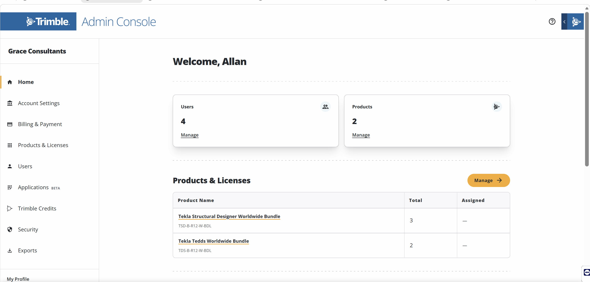
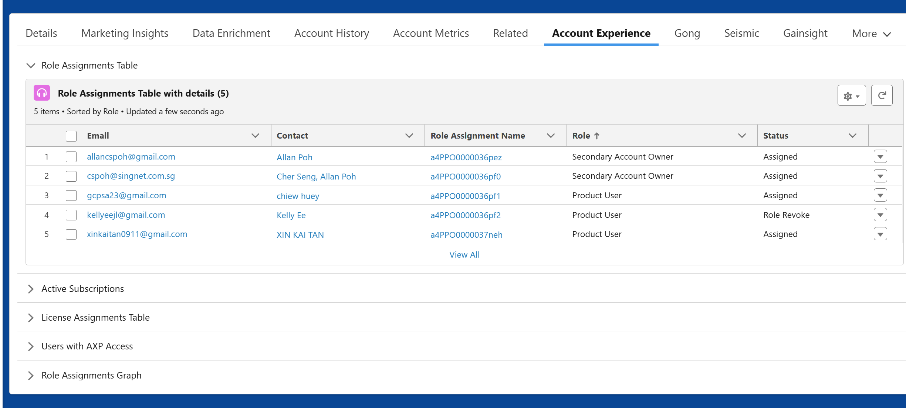
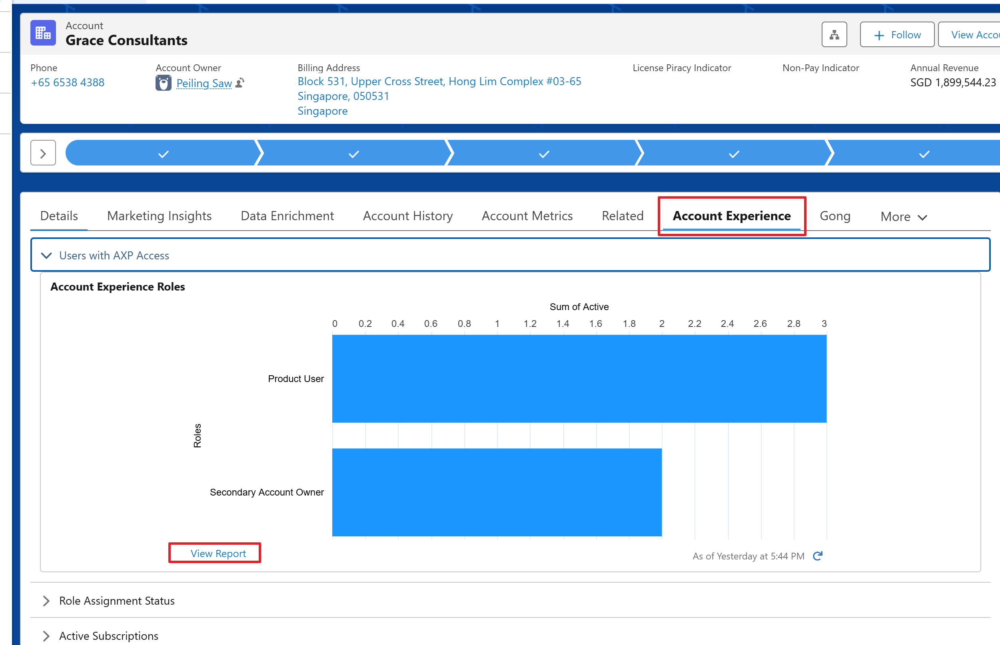
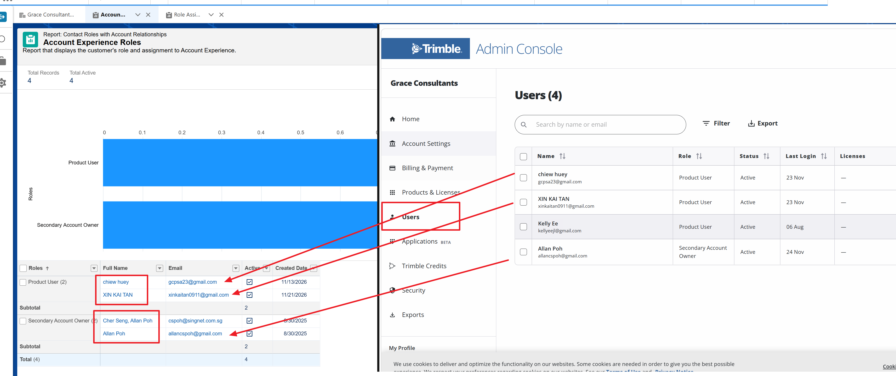
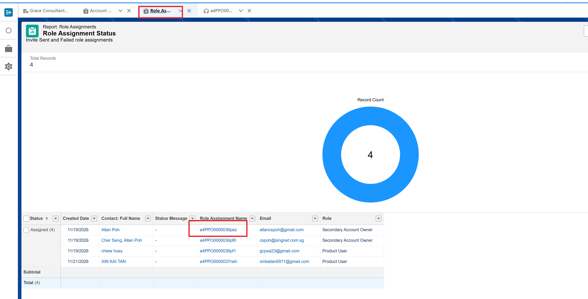
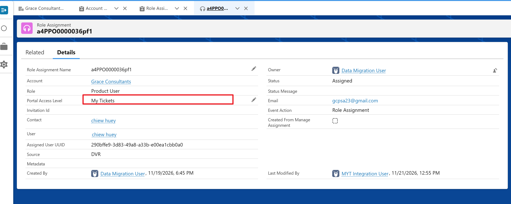

# Admin Console and Support Center Quick Guide

!!! info "Background – Tekla EMSv4 Update"
    Trimble is bringing together the way accounts, users and licences are managed. In the first phase, all users from active customer accounts in the **Tekla Online Admin Tool** have been moved to the **Trimble Admin Console**. This covers all Trimble direct customer accounts (excluding China) and all resellers' customer accounts.

    **User account migration date:** Saturday 21st November 2026

    **Please note -** this phase moves **users only, not product licences**. HQ will send updates as the next phases begin.

---

## 1. What Has Changed for Tekla Account Administrators

| Topic | What to expect |
|---|---|
| **Licence management** | Administrators **keep managing Tekla licences in the Tekla Online Admin Tool** for now. They can see their users in the Admin Console, but not their Tekla products. |
| **User management** | Users can still be managed in the Tekla Online Admin Tool, but **users can only be removed in the Admin Console**. |
| **Synchronisation** | Tekla users are kept in sync between the Tekla Online Admin Tool and the Admin Console. |
| **Changes made in Admin Console** | If an administrator changes a member in the Admin Console (for example, giving or removing an Admin role), that user must be managed in the Admin Console from then on. Users can still be invited from the Tekla Online Admin Tool. |
| **Product-specific roles** | These are still granted in the **Tekla Online Admin Tool** for all users. |
| **Support Center** | All users in Trimble direct regions get access to the Trimble Support Center. Administrators can limit this in the Admin Console. **Users in reseller accounts do not have Support Center access.** |

---

## 2. Accessing the Admin Console

| Resource | Link |
|---|---|
| Admin Console (Trimble Account Services) | [accounts.trimble.com](https://accounts.trimble.com/){:Target="blank"} |
| Tekla Online Admin Tool Product Guide | [help.trimble.com – Admin Tool](https://help.trimble.com/doc/tekla-structures/not-version-specific/admintool_intro){:Target="blank"} |
| Trimble Account Services Help | [help.trimble.com – Trimble Account Services](https://help.trimble.com/doc/trimble-account-services/trimble-account-services/welcome-to-trimble-account-services){:Target="blank"} |
| Getting Started with the Admin Console (video) | [Watch the video HERE](https://videos.trimble.com/construction/watch/8yRQsVCnk1bLV8rXUuAbZi){:Target="blank"} |

---

Once signed in, administrators can see their account's users and products in the Admin Console, but they cannot assign licences there yet. Tekla licences are still assigned in the Tekla Online Admin Tool.

{width="95%"}

## 3. Viewing a Customer's Admin Console Users in Salesforce

You can see who has Admin Console access, and which role they hold, from the customer's account in Salesforce.

1. Open the customer **Account** in Salesforce.
2. Select the **Account Experience** tab.
3. Under **Role Assignments Table**, **Role Assignments Table with details** directly displays each user's **Email**, **Contact**, **Role Assignment Name**, **Role** and **Status** (click **View All** if there are more records).

{width="95%"}

{width="95%"}

{width="95%"}

!!! tip
    **Role Assignments Table with details** shows all role assignment statuses (for example *Assigned*, *Role Revoke*, *Invite Sent*, *Invite Expired* or *Failed*). Always check that the email address the customer uses matches the one on the record.

---

## 4. Role Assignment

A user needs a role before they can use the Admin Console and the Support Center.

### 4.1 Persona Roles

| Role | Access | Key points |
|---|---|---|
| **Account Owner** | Full access to the account: account details (for example invoices and addresses), plus user and licence management. | The highest role. **Only one user** can hold it. The person is set in the **"License Management Account Owner"** field on the quote/order. |
| **Secondary Account Owner** | Almost the same access as the Account Owner. | More than one user can hold it. **Cannot transfer** the Account Owner role. |
| **Company Admin** | Manages users and licences only. | Cannot change role assignments or see account details such as invoices. Shown to customers as **"License Admin"** in the Admin Console. Can add other Company Admins. |
| **Product User** | Access to products only. | Cannot manage licences or open the Admin Console. Needed for a licence assignment, so it's **added automatically** when a licence is assigned. Also gives Support Center access, so assign this role when someone only needs the Support Center. |

### 4.2 Support Center Permissions

Each role also has one of three Support Center access levels:

| Access level | What the user can do | Community licence |
|---|---|---|
| **All Tickets** | Create and view their own cases **and all cases logged under their account(s)**, based on their account contact relationship records. Can give *My Tickets* or *All Tickets* access to others. | Plus |
| **My Tickets** | Create and view **their own cases only**. Can give *My Tickets* access to others. | Base |
| **No Access** | Cannot log in to the Support Center. | None |

!!! note
    Account Owners and Secondary Account Owners must always have **All Tickets**, because of what their role covers. If one of them shows a different access level, raise it as a data discrepancy.

---

## 5. Checking a User's Support Center Access Level

1. From the **Account Experience** tab, expand **Role Assignments Table** to view **Role Assignments Table with details**.
2. In the **Role Assignment Name** column, click the user's record (for example *a4PPO0000036pf1*).

    {width="95%"}

3. On the **Details** tab, the **Portal Access Level** field shows the user's Support Center access (*All Tickets*, *My Tickets* or *No Access*).

    {width="95%"}

!!! tip "User cannot access the Support Center?"
    If **Portal Access Level** shows **No Access** for a Product User or License Admin, this is usually **on purpose**: an authorised person at the customer has set it. Please ask the user to contact their **Account Owner or Secondary Account Owner** to request access.

---

## 6. Licence Assignment – Important

!!! danger "Do not assign licences on behalf of customers"
    Support staff **must not** assign or change licences for customers. Customers manage their own users and licences, so please ask the user to contact **their company's administrator** (Account Owner, Secondary Account Owner or License Admin) for any licence request.

    Support Center access levels can only be changed by an authorised person at the customer, in the Admin Console.

---

## 7. Further Reading

For more detailed troubleshooting, including role assignment statuses, provisioning failures and escalations, please see the internal **[Accounts and Licenses Troubleshooting – L1 Support Runbook](https://docs.google.com/document/d/1OwJBIqHIjHADfMdaaZV_G1F1PnOsMTPJ_L5vme2JhyQ/edit?tab=t.0)**{:Target="blank"}.

---

!!! warning "Please note – Internal vs External Accounts"
    **Only external (customer) accounts** have been moved to the Admin Console. **Internal Trimble staff accounts stay on the Tekla Online Admin Tool** for now. HQ will move internal accounts later, but no date has been set yet because the current focus is on customer accounts.