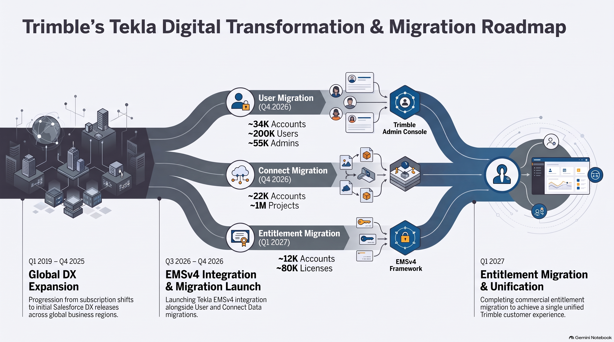
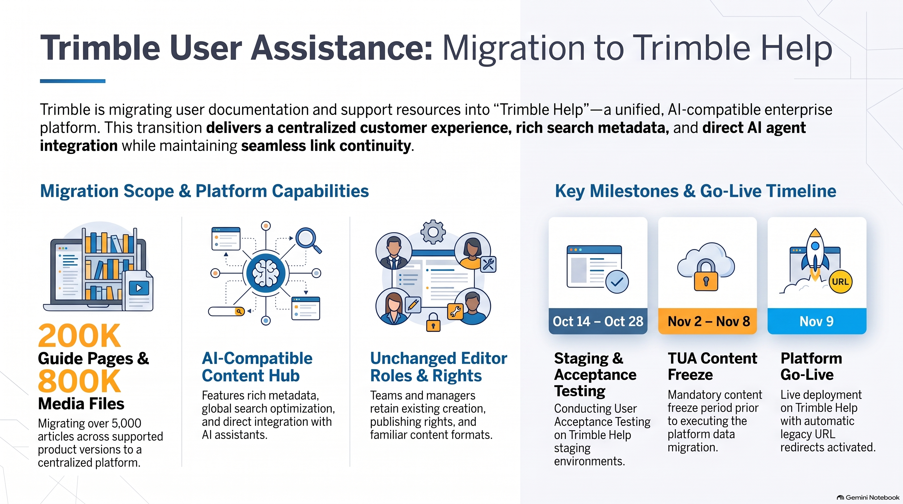

# Trimble Digital Transformation and Migration

!!! note "Reference Documents"
	This guide is based on the following original presentations:
	
	* [Trimble Help Migration Presentation](https://docs.google.com/presentation/d/14bSvZtc0W0W5RAJEDivLsLjGWo1rDGkxq7mK5Z_aV0Q/edit?slide=id.g3dc3ce2451d_0_0#slide=id.g3dc3ce2451d_0_0){:Target="blank"}
	
	* [Tekla DX Journey Presentation](https://docs.google.com/presentation/d/1n1dR6EpXfm4Ws8te6OHaFCWxY7hZ5pwmOpgIg7ElJi0/edit?slide=id.g3d07f2be667_0_5596#slide=id.g3d07f2be667_0_5596){:Target="blank"}
	
	For further technical details and troubleshooting, please refer to the file Trimble Digital Transformation Technical FAQ.

The Digital Transformation (DX) at Trimble goes beyond just technology. It is a complete digital ecosystem designed to provide customers with an effortless experience throughout their entire journey with Trimble products.

    <h2 style="margin: 0; color: #005a8c; font-size: 1.5rem; font-weight: 300; border-bottom: none; padding: 0;">Tekla DX Journey & System Migrations</h2>

The ongoing digital transformation impacts all customers using Tekla products, shifting tools to a unified Trimble Admin Console and a new Entitlement Management System (EMSv4). The roll-out consists of three major migrations:

1. **User Migration (November 2026):** 
Impacts approximately 34K customer accounts, 200K user accounts, and 55K admins. This enables users to manage roles, billing, and security through the Trimble Admin Console.
2. **Connect Migration (November 2026):** 
Encompasses around 22K customer accounts and 1M projects. 
3. **Entitlement Migration (Q1 2027):** 
Affects roughly 12K customer accounts and 80K licenses. All users with a Named User License Subscription will switch to EMSv4 entitlements. 

!!! info "Visual Guide: Digital Transformation Roadmap"
	{ loading=eager }
	**Review the roadmap above for a visual breakdown of the global DX expansion and timelines.**

    <h2 style="margin: 0; color: #005a8c; font-size: 1.5rem; font-weight: 300; border-bottom: none; padding: 0;">Trimble User Assistance (TUA) Content Migration</h2>

To provide a unified, seamless customer experience, Trimble is migrating legacy user documentation and support resources from Trimble User Assistance (TUA) to **Trimble Help**. 

Trimble Help serves as the centralized, AI-compatible hub for all public product documentation.

**Migration Scale & Scope:**

* 200,000 Tekla Structures guide pages
* 800,000 images and videos.
* 5,000 articles and 242 users with editor/manager roles.

**Timeline & Action Points:**

* **Oct 14 - Oct 28, 2026:** User Acceptance Testing (UAT) on the Trimble Help staging environment.
* **Nov 2 - Nov 8, 2026:** Content freeze period in TUA and final content migration[cite: 1]. Editors must respect this freeze period.
* **November 9, 2026:** Go-live on Trimble Help[cite: 1]. Legacy URL redirects will become active to ensure existing bookmarks and context-sensitive help continue to work seamlessly.
* **December 2026:** Sunset of the legacy Trimble User Assistance platform.

!!! info "Visual Guide: User Assistance Migration Overview"
	{ loading=eager }
	**Refer to the overview above for platform capabilities and critical milestones.**

---

**Next Steps for Editors:**

Publish any draft content needed for migration, update relevant links to point to the new platform, and prepare to continue managing your familiar content types directly within Trimble Help after the go-live.

    <h2 style="margin: 0; color: #005a8c; font-size: 1.5rem; font-weight: 300; border-bottom: none; padding: 0;">Frequently Asked Questions (FAQ)</h2>

### Trimble's Digital Transformation (DX) - The Journey Continues

??? faq "How (in saleswise) has the Tedds sales started in eCom?"
    As of September 2026, Tekla Tedds is available for purchase from the trimble.com website via the eCom sales channel. It is available to purchase in the USA, UK and Ireland in the appropriate currencies. As of the start of October, the first handful of orders have been processed with orders from both the USA and UK. 

??? faq "Any information about licensing for offgrid users after TS2027?"
    Please refer to the following internal slides for detailed information on offgrid user licensing: [View Internal Presentation](https://docs.google.com/presentation/d/1zisLNnnQj76f_-mWH1Z079aUTLL9tPKNwPneuMZUmIU/edit?slide=id.g3f8cb15e5bf_0_0#slide=id.g3f8cb15e5bf_0_0)

??? faq "Invoices for customers who have other Trimble products but use a reseller for Tekla. Will they see other invoices?"
    When using the Admin Console, the Invoices and Orders an administrator sees depend on the customer account they have selected. A user with a single Trimble Identity can belong to multiple customer accounts in DX Salesforce. If a customer has purchased both directly via Trimble and indirectly via a reseller partner, they will typically have a separate customer account for each and therefore will only see their Direct orders when they have that account selected in the Admin Console. When the Indirect account is selected, they will not see any orders or invoices. 

??? faq "In ATC we have the ability to End a user’s session in Tekla PowerFab/Structures. Will we have that functionality in the Admin Console?"
    No. The ability to end the user's session remains accessible in the Tekla Online Admin Tool. Currently, the Admin Console has no knowledge of when a license is in use and therefore has no features for managing the use of the licenses. The Admin Console can only be used to assign and reassign an entitlement. 

---

### Trimble Help and Trimble User Assistance Content Migration

??? faq "In the Admin Console, what would it take to change the link to courses on Trimble Learn so it is specific to the relevant licenses?"
    Users who have access to EMSv4 entitlements will see related product cards in My Products (https://accounts.trimble.com/products). Product marketing is responsible for defining the contents for product cards and can help with updating the link.

??? faq "Will previous TUA links automatically get redirected, or will users get an error?"
    Trimble User Assistance URLs will be redirected to the corresponding content migrated to Trimble Help. We will actively be monitoring requests and adjust redirects as needed after the transition to Trimble Help.

??? faq "Will searching in one language only return results from that language, or will it show all related content in any language?"
    The traditional search is language-specific. Search results will be returned from the language you have selected. If you use an AAIP agent, it will fallback to English when retrieving knowledge from the Trimble Search, and the generated answer will be returned in the language you used when asking the question.

??? faq "Would it be helpful to connect the content from Trimble Learn via the Learn MCP server as a data source for the Trimble Help agents?"
    Yes. The Learn MCP server should be made available as a Connector in Trimble Agent Studio so that all AAIP agents can use it.

??? faq "What is the grouping criteria for what’s listed on Trimble Help? Is it workflows our users can investigate, or just the product names based on SKUs we sell?"
    On the Trimble documentation page, the grouping criteria is by product. All the content available on Trimble Help is tagged with metadata such as product, version, etc. Within the documentation related to a product, the grouping can be by component/application, for example, like in the Trimble Connect case.

??? faq "Can Trimble Help consume all KB articles from Salesforce DX, or is there a way to check that all articles have been indexed by AI?"
    Trimble Help can consume KBs which are tagged with Article Product values corresponding to products onboarded to Trimble Help. If the product value isn’t a 1:1 match in DX Salesforce and Trimble Help, we can map multiple Article Product values to one product value in Trimble Help.

??? faq "When queries are submitted directly from software like Tekla Structures, are they routed to the global support team or directly to the regional support queue?"
    Currently and during the Tekla DX transition phase, support cases submitted by Tekla customers are delivered to the local support teams or to the reseller support teams. When the Tekla DX transition phase is completed, support cases submitted by Tekla customers will be delivered to one common support queue from which local support teams pick cases. Cases submitted by reseller customers will still be delivered directly to the reseller support teams.